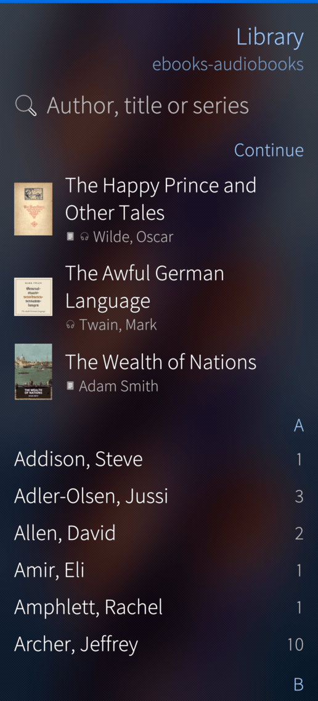
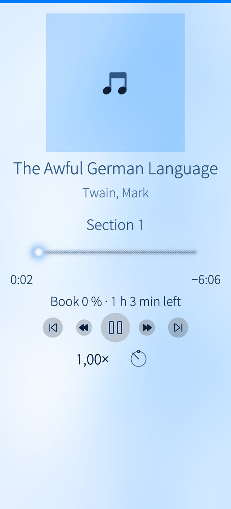
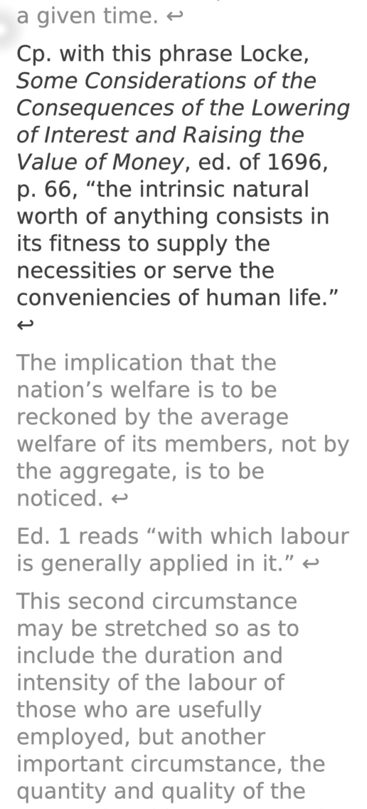
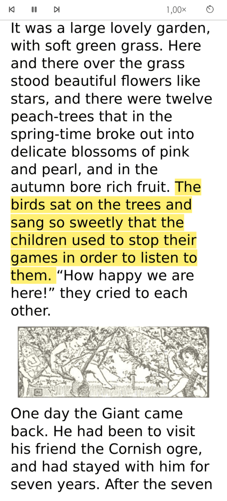
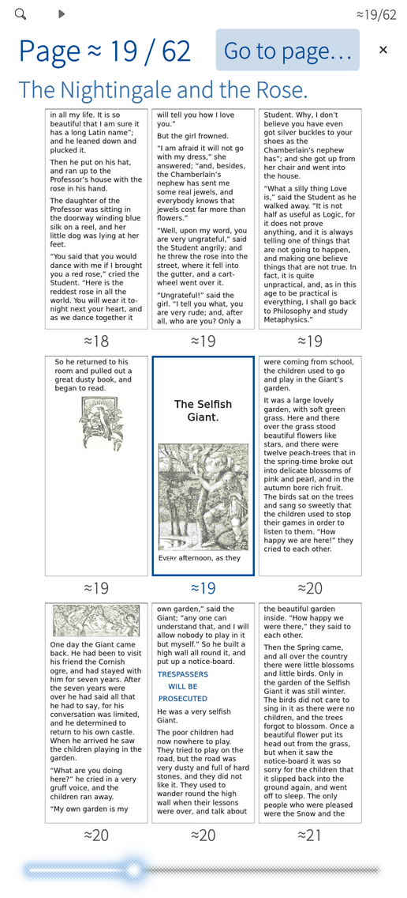
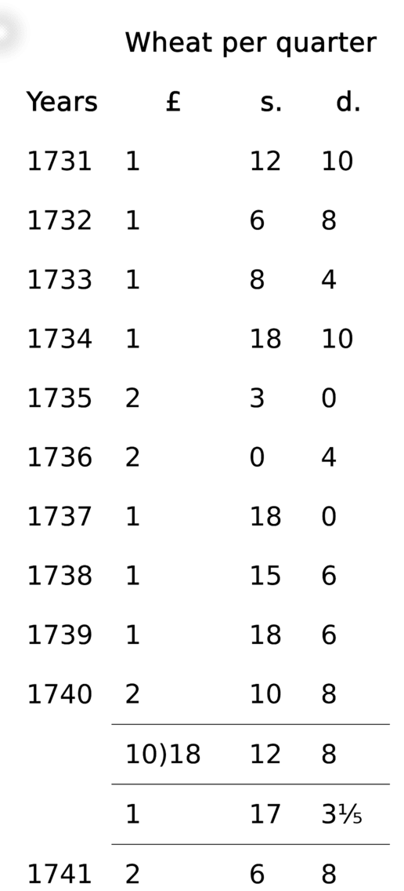

# Bookfish

E-books and audiobooks in one app for Sailfish OS: a library for both, an
audiobook player with a sleep timer, and an EPUB reader. It also plays
readalouds, books with synchronized narration.

**Status:** first release, 0.1. Tested on a Jolla Phone (Sailfish OS 5.2)
and a Sony Xperia 10 III (Sailfish OS 5.0). The interface is in English.

<p>




</p>

## Highlights

- **One library for e-books and audiobooks:** EPUB books, M4B files and MP3
  files or folders, in Documents, Music and on memory cards; by author,
  series in order, with covers and search, the last three books opened on
  top. An audiobook named like its EPUB is listed with the book.
- **An audiobook player with a sleep timer built in:** stop after 15, 30,
  45, 60 or 90 minutes, fading out gently, or at the end of the chapter.
  Play, pause and 30 seconds back or forward also from the lock screen and
  the headphones.
- **It keeps your place:** saved every 20 seconds while playing and
  whenever playback stops, also when Sailfish OS stops it (Bluetooth
  headphones out of range, a call, an alarm). The history notes where you
  were every five minutes, so you find your place again, also after falling
  asleep.
- **An EPUB reader that keeps its settings:** serif or sans serif font,
  text size, line and paragraph spacing; light or dark page; portrait, or
  landscape in one or two columns; printed page numbers where the book has
  them.
- **Flip through the book:** nine pages at a glance, across chapters, to
  find a place by how it looks.
- **Pictures, tables and notes in their own views:** zoom a picture or a
  table; read a footnote without losing your page. Useful for scholarly
  books with many notes and tables.
- **Dictionary and history:** look up a word offline in a dictionary of
  dict.cc (request it free from dict.cc); select text to copy, bookmark or
  note it; go back to where you read or listened.
- **Readalouds:** EPUB 3 books with synchronized narration. Tap a sentence
  to listen from there. The built-in guide is a readaloud, so you can try it
  at once.
- **Private:** no network permission; Bookfish runs in the Sailfish OS
  sandbox and sends nothing anywhere.

## Installing

Download the RPM of the latest
[release](https://github.com/uli-pro/harbour-bookfish/releases) on the
phone and open it in the file manager (Settings → Untrusted software must
allow it), or with developer mode:

```
pkcon install-local harbour-bookfish-*.noarch.rpm
```

Start Bookfish from its icon the first time: Sailfish OS then asks for the
permissions below.

## A tidy library

Bookfish shows what the files say, and many EPUBs, bought or downloaded,
are messy: one book has the author's sort name "Twain, Mark", the next has
none and is listed under M; the series is missing or written into the
title. The library looks as tidy as the metadata of your books. In practice
that means tidying them yourself, for example with
[calibre](https://calibre-ebook.com/) or a script.

What Bookfish reads:

- **EPUB books:** the title (`dc:title`); the authors (`dc:creator`),
  grouped by the first author's sort name (the EPUB 3 `file-as` refinement
  or `opf:file-as`, such as "Twain, Mark"; without one, the name as
  written, so "Mark Twain" is listed under M); the series and its number
  (`calibre:series` and `calibre:series_index`, or EPUB 3
  `belongs-to-collection` with `group-position`); the cover in the book.
- **Audiobooks without an EPUB of the same name:** the title from the tag
  `album` (a single file: the shorter of `title` and `album`), the author
  from `albumartist`, else `artist` (in a folder of one author's EPUB books,
  that author), the series as described under All features → Library, the
  cover from `cover.jpg` or `cover.png` in a folder, else the picture in the
  file.

Tips:

- In calibre, set the author sort, title and series with its number, then
  write them into the files themselves, for example with Polish books →
  Update metadata in the book files: until then calibre keeps them only in
  its own database.
- Audiobooks have no sort name: write the author in their tags as
  "Twain, Mark" to have them listed with the author's books.
- Put an audiobook next to its EPUB under the same name (the folder `Book/`
  or the file `Book.mp3` or `Book.m4b` next to `Book.epub`): it then takes
  the title, author, series and cover of the book.
- A single M4B or MP3 file with chapter marks gives a chapter list with
  titles; in a folder, each MP3 file is a chapter. M4B files jump exactly
  to a time, MP3 files may not (see below).

## Readalouds

A readaloud is an EPUB 3 book with synchronized narration (EPUB Media
Overlays): the sentence being spoken is marked, and you can switch between
reading and listening at any sentence. To see one, open *Welcome to
Bookfish*, the guide that comes with the app.

Making your own needs the EPUB and the audiobook of the same edition and an
aligner such as [Storyteller](https://storyteller-platform.dev/), which you
host yourself and which runs speech recognition over the audio. This takes
some setup and computing time; Bookfish then opens the result like any
other book.

## All features

<p>



</p>
<p>


</p>

- **Guide:** a short readaloud, *Welcome to Bookfish*, opens on the first
  start and stays in the library (author Finn Bookfish): each page explains
  a feature and lets you try it.
- **Library:** EPUB books and audiobooks in Documents, Music and on memory
  cards, or in a folder chosen in the pull-down menu. An audiobook is an M4B
  file, an MP3 file next to EPUB books (a folder of an author's books), or a
  folder of MP3 files without EPUB books, each file a chapter in the order
  of the file names. An audiobook named like an EPUB book next to it (the
  folder `Book/` or the file `Book.mp3` next to `Book.epub`) is listed with
  the title, author, series and cover of that book. Other audiobooks take
  their series from the tags `SERIES` and `SERIES-PART` (MP3: `TXXX`, M4B:
  `----:com.apple.iTunes:`), else from iTunes' movement tags (`MVNM`/`MVIN`,
  `©mvn`/`©mvi`). Icons tell books, audiobooks and readalouds apart.
- **Audiobooks** open a player: chapter, place in it and time left in the
  book; back and forward by chapter or 30 seconds (the lock screen and the
  headphones: 30 seconds, as a chapter can last an hour). Contents lists the
  chapters with their start times, History where you listened. The place is
  saved to the second. A folder opens at once; until its files have been
  read once, chapter lengths are estimated from the file sizes.
- **Sleep timer** (button in the playback bar or the player): stop after 15
  to 90 minutes, fading out over the last 20 seconds, or at the end of the
  chapter.
- The place heard is saved whenever listening stops, also when the phone
  stops it (Bluetooth headphones out of range, an alarm, a call). After an
  alarm or a call listening goes on by itself; after losing the headphones
  it does not.
- **Book and audiobook of the same title** (not a readaloud) keep their own
  places. Opening one after the other was used later offers to go to about
  the same share of the book ("Listened to 43 %", "Go there"); the top of
  its history page always shows that place. The share is rough: front
  matter and appendices move it.
- **Turn pages** by swiping, or by tapping the left or right edge.
- **Page numbers** are those of the printed book where the EPUB has a page
  list ("143/380"; Roman numerals of the front matter without the total).
  Otherwise they are estimated from the length of the text ("≈143/380"), so
  they stay the same at any text size. The contents, bookmarks and search
  hits show them too.
- **Flip through the book:** tap the page number. Nine pages are shown, the
  current one in the middle; swipe, tap beside them or drag the bar below to
  move through the book, also across chapters. Tap a page to read on there,
  or close the view to return to where you were. "Go to page…" takes a page
  number.
- **Pictures:** press and hold a picture to see it on its own page. Pinch
  or double tap to zoom; the phone may be turned. Listening goes on. Small
  pictures such as ornaments do not open.
- **Tables** too wide for the page get smaller text; those taller than a
  page are broken into rows. The first cell of each table and its caption
  are blue: press and hold them to see the table as the book made it, as a
  picture to zoom.
- **Notes and links:** links into the book are coloured. Press and hold a
  note's mark (also just beside it) to read the note on its own page, with
  the notes around it to scroll to; listening goes on. Press and hold any
  other link, such as a chapter in the book's contents, to go there; the
  history leads back. Bookfish tells notes from other links by their form,
  as few books mark them: a short mark ("12", "*", "a") within the text,
  leading to a place that is no chapter.
- **Select text:** press and hold a word, drag the handles to select more.
  The buttons copy the text, make a bookmark or a note, or look it up.
- **Dictionary:** a selected word or phrase is looked up in a dictionary
  of [dict.cc](https://www.dict.cc/) on the phone, without network.
  Bookfish brings no dictionary: request the one for your languages from
  [dict.cc](https://www1.dict.cc/translation_file_request.php) (free for
  personal use), put the file you get into Documents and import it in the
  settings. The file may be deleted afterwards. The book's language chooses
  the dictionary, the settings the language to translate into (the
  phone's, unless chosen). Inflected English words and phrases find their base form
  ("went", "kicked the bucket", "gave him the cold shoulder").
- **Find & history** (pull-down menu) searches the book for paragraphs
  holding all words typed, in any order. A line in the hits shows where you
  are.
- **History:** the same page, with nothing typed, lists where you read and
  listened: where it started, every five minutes, and where it ended. When
  reading, also the page you left for the contents, a search hit or the
  history, like a back button. Tap an entry to go there.
- **Turning the phone:** Bookfish turns with the phone, or keeps the
  orientation chosen in the settings, also when the phone's orientation is
  locked. In landscape the page shows text only, in one or two columns;
  tap a sentence to start or pause narration.
- **Settings** (pull-down menu of a book or the player): Text (size, line
  and paragraph spacing, font, columns in landscape), Playback and timer,
  Button bar (size, top or bottom), Dictionary, Orientation, Colour mode.
- **Readalouds:** listen by tapping a sentence: narration starts there.
  Tapping where there is no sentence starts at the top of the page. Tapping
  the sentence being spoken pauses; tapping it again goes on. When a book is
  opened again, the sentence heard last is marked; tap it to go on
  listening.

## Permissions and security

Bookfish runs in the Sailfish OS sandbox with these permissions only:

- **Documents** and **RemovableMedia**: to find and read books in Documents
  and on memory cards. Bookfish never writes there.
- **Music**: to find books and audiobooks in the music folder. Bookfish
  never writes there.
- **Audio**: to play narration and audiobooks, also on the lock screen and
  the headphones.
- **WebView**: to show the pages of a book.

It has no network permission: a book cannot load anything from the
internet, and Bookfish sends nothing anywhere. Books are unpacked into the
app's cache with limits against crafted files (paths leaving the book,
symbolic links, zip bombs, oversized or deeply nested files); scripts in
books do not run. Positions, history, bookmarks and notes stay in the app's
own folder on the phone.

Release packages carry a GitHub build attestation: it proves that the RPM
was built by this repository's workflow `build.yml` from a tag. Check it
with `gh attestation verify <rpm> --repo uli-pro/harbour-bookfish`.

## What Bookfish is not

- No synchronization: places, bookmarks and notes stay on the phone.
- EPUB, M4B and MP3 only: no PDF, MOBI, comics or other formats.
- Books with DRM cannot be opened.
- The interface is English; translations are welcome (see Translating).
- Not in a store yet: install it from the releases.
- In MP3 files, jumps to a time (30 seconds back, the slider, a chapter
  inside a file) can land several seconds early, more in long files; this
  comes from GStreamer, which finds the place from a rough table in the
  file. M4B files are exact.

## Feedback and maintenance

Bookfish is a personal project, maintained in spare time. The maintainer
reads and listens with it every day; it is currently the app he uses most
on his phone. So it will be kept working on new Sailfish OS releases.

- Bug reports are welcome as
  [issues](https://github.com/uli-pro/harbour-bookfish/issues); please
  name your phone and Sailfish OS version.
- Feature requests are welcome too, but there is no guaranteed response
  or schedule. What gets added is what fits how the app is used.
- Pull requests: please open an issue first, except for translations.

## Translating

The interface is English; every text goes through `qsTr()`, and building
updates the template `translations/harbour-bookfish.ts`. To add a language,
for example German:

1. Add `TRANSLATIONS += translations/harbour-bookfish-de.ts` to
   `harbour-bookfish.pro` and build once; this creates the file.
2. Translate it with Qt Linguist (`linguist`), keeping the placeholders
   (`%1`) and reading the translator comments.
3. Open a pull request.

## Building

Requires the [Sailfish SDK](https://docs.sailfishos.org/Tools/Sailfish_SDK/).

```
mkdir -p ~/build/bookfish && cd ~/build/bookfish
sfdk config target=SailfishOS-5.1.0.11-aarch64
sfdk build /path/to/harbour-bookfish
```

GitHub Actions run the unit tests and the QML check, build the RPM and
check it with the Harbour validator for every pull request; a tag drafts a
release.

## Checking the QML

The build does not parse the QML, so a syntax error would only show on the
phone. `tools/check_qml.py` runs `qmllint` from Qt 5 on every QML file and
looks for JavaScript newer than ES5, which Qt 5.6 on the phone does not run
(`let`, `=>`, `findIndex` and the like; comments and strings are skipped),
and for QML newer than Qt 5.6 (`required property`, inline components).
A line that is fine on Qt 5.6 but looks newer (a Canvas `ctx.fill()`, say)
can be marked with `// es5-ok`. The check needs the Qt 5 QML tools
(`qt5-qtdeclarative-devel` on Fedora, `qtdeclarative5-dev-tools` on Debian
and Ubuntu).

```
python3 tools/check_qml.py
```

## Running tests

The Python modules in `python/bookfish/` use only the standard library
(`bridge.py` imports PyOtherSide only to send events) and are tested without
the SDK. They must work with Python 3.8 (Sailfish OS up to 5.0) and 3.11
(from 5.1).

```
cd /path/to/harbour-bookfish
PYTHONPATH=python python3 -B -m unittest discover -s tests -t .
```

With containers, for the Python versions found on devices:

```
for v in 3.8 3.11; do
  podman run --rm --security-opt label=disable -v "$PWD":/src:ro -w /src \
    -e PYTHONPATH=python docker.io/library/python:$v-slim \
    python -B -m unittest discover -s tests -t .
done
```

## How this app is made

Bookfish is made by one person working with an AI assistant (Claude by Anthropic).

- Ulrich Probst (maintainer) decides what the app does and how it behaves:
  features, design and priorities. He approves a written specification
  before each step and tests every change on his own phone.
- The AI writes the code, tests and documentation and proposes the
  technical solutions.
- Every change is checked by unit tests, the Harbour validator and an
  independent second AI review. The maintainer does not review the code
  line by line.

## License

GPL-3.0-or-later, see [LICENSE](LICENSE).

The dictionary feature uses dictionaries of dict.cc, whose terms require
programs using them to be under the GPL; so Bookfish went back from MIT to
the GPL. Bookfish contains no data of dict.cc, not even for its tests: each
user requests the dictionary from dict.cc.
